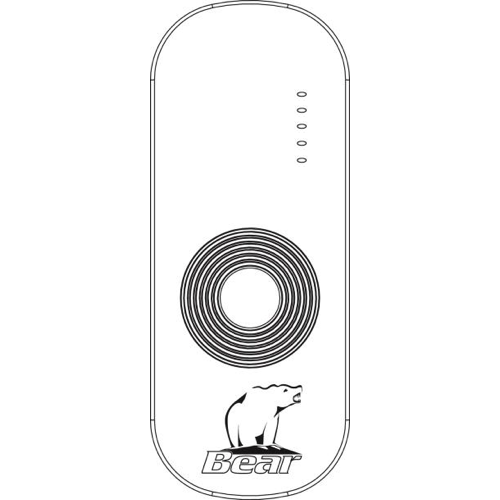

# Homey app for "Bear" blind and awning automation

<br>
<div align="center">
  
</div>
<br>

Control Bear outdoor blinds and awnings from Homey, by emulating the 5-channel 433 MHz Bear remote.

What works:

* Up, stop and down, on Homey's native blind control.
* Each of the remote's five channels as its own device.
* Pairing learns your own handset's address, so the app controls only *your* blinds.
* Homey follows the physical remote, including the ALL button, updates Homey's state.
* Flow cards for up/stop/down, generated by Homey from the standard blind capability.

Not supported:

* **Position.** The motors send nothing back, so there is no way to know where one actually is.
  Homey shows a blind as moving for its configured travel time after a command, then as idle.

## Pairing

Homey learns which motors to talk to by listening to your existing remote. When adding a device,
hold the handset near Homey and press any button. Homey captures the remote's address and offers
all five channels; tick the ones you want.

Set each blind's **travel time** in its device settings — how long it takes to run from one end to
the other. Homey uses it to stop showing the blind as moving.

## Protocol

The 433 MHz protocol was reverse-engineered from captures made with Homey's built-in RF signal
recorder. See [RF_PROTOCOL.md](RF_PROTOCOL.md) for the frame layout, the decoded tables, and how to
capture and decode additional commands.

## Development

```bash
npm test
homey app validate --level verified
homey app run
```

`app.json` is generated from `.homeycompose/` by `homey app build` and committed; `npm test` fails
if the two drift apart.
